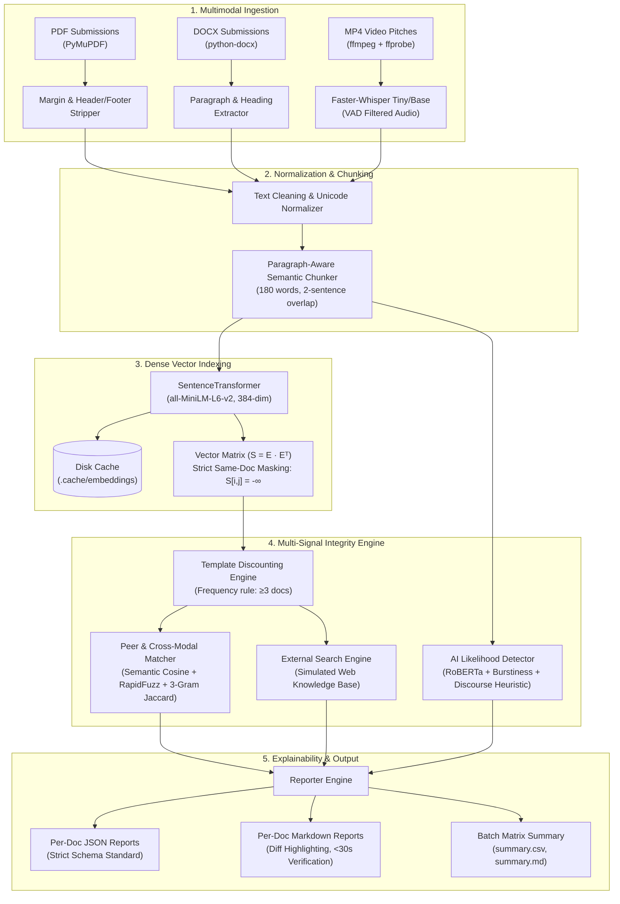
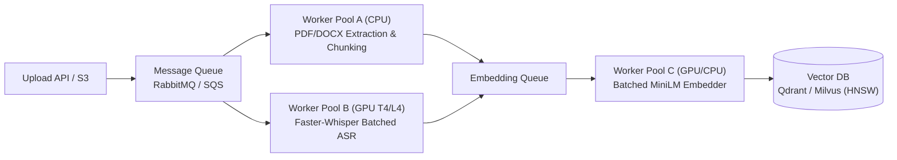

# Multimodal Submission Integrity & Plagiarism Detection Engine

An end-to-end, multi-factor content verification and plagiarism detection pipeline designed for high-stakes academic evaluations and large-scale case competitions. The system ingests **PDF reports**, **DOCX executive summaries**, and **MP4 video pitches**, normalizes and indexes their semantic representations, detects cross-modal and paraphrased overlaps, isolates common prompt boilerplate, estimates AI-generated probability, and outputs audit-ready, human-verifiable reports in under 30 seconds.

---

## 1. System Architecture



---

## 2. Quickstart: Setup & Execution in One Command

### System Prerequisites
- **Python 3.10+** (Tested on Python 3.10 – 3.13)
- **FFmpeg & FFprobe**:
  - Windows: `winget install Gyan.FFmpeg`
  - Ubuntu/Debian: `sudo apt update && sudo apt install -y ffmpeg`
  - macOS: `brew install ffmpeg`

### Single-Command Setup
Clone the repository, create a virtual environment, and install dependencies:

```bash
git clone https://github.com/your-username/multimodal-integrity-engine.git
cd multimodal-integrity-engine
python -m venv .venv

# Activate virtual environment
# Windows:
.venv\Scripts\activate
# Linux/macOS:
source .venv/bin/activate

# Install requirements and pre-cache models
pip install -r requirements.txt && python download_models.py
```

### Running the Pipeline
Run verification on the included sample submissions:

```bash
python run_integrity_check.py --input_dir ./sample_submissions --output_dir ./reports
```

### Running the Evaluation Benchmark & Unit Tests
```bash
# Run automated benchmark and generate EVALUATION.md
python scripts/evaluate.py

# Run unit and integration test suite
pytest tests/
```

---

## 3. Core Methodology & Mathematical Mechanics

### A. Multimodal Ingestion & Robustness
- **PDF Extraction (`pymupdf`):** Analyzes bounding boxes across all pages. Lines within the top and bottom 8% margins that repeat across $\ge 50\%$ of pages (after digit masking) are classified as headers/footers and stripped. Scanned or zero-byte PDFs return structured warnings and never crash the process.
- **DOCX Extraction (`python-docx`):** Traverses body XML elements and tables sequentially. Headers and footers are physically excluded by reading only document body streams. Tracks paragraph indices and the nearest heading context.
- **Video Extraction (`ffmpeg` + `faster-whisper`):** Verifies the presence of audio streams via `ffprobe`. Silent videos (no audio track) are flagged gracefully. Extracts 16 kHz mono WAV and transcribes using `faster-whisper` (`tiny` or `base`, `compute_type="int8"`, `vad_filter=True`), recording exact segment timestamps ($hh:mm:ss$).

### B. Paragraph-Aware Semantic Chunking
- Tuned for `sentence-transformers/all-MiniLM-L6-v2`, which has a **256 word-piece token limit** (longer passages are silently truncated).
- Chunks are sized at **180 words (~240 tokens)** with a **2-sentence overlap**.
- Preserves paragraph and section boundaries to prevent prompt headers from bleeding into original analytical answers.

### C. Dense Vector Indexing & Strict Masking
- Embeddings are generated with `all-MiniLM-L6-v2` (384 dimensions) and normalized using L2 norm ($\|e\|_2 = 1.0$).
- Under normalization, cosine similarity simplifies to matrix dot product:
  $$S = E \cdot E^T$$
- **Strict Same-Document Exclusion:** Rather than merely clearing the diagonal, the sub-matrix block corresponding to the same document is masked:
  $$S[i, j] = -\infty \quad \forall i, j \text{ where } \text{doc\_id}(i) = \text{doc\_id}(j)$$
  This guarantees that self-matches and overlapping chunks within the same submission cannot trigger false plagiarism alerts.

### D. Lexical vs. Semantic Metric Duality
To reliably distinguish verbatim copying from semantic paraphrasing:
- **Exact / Near-Exact Copy:** $\text{Cosine} \ge 0.92$ and $\text{Lexical Ratio} \ge 0.70$.
- **Semantic Paraphrase:** $\text{Cosine} \ge 0.80$ and $\text{Lexical Ratio} < 0.70$.
- Uses `rapidfuzz` (`fuzz.ratio`) and word 3-gram Jaccard distance:
  $$J(A, B) = \frac{|N_3(A) \cap N_3(B)|}{|N_3(A) \cup N_3(B)|}$$

### E. Template & Boilerplate Discounting (Scenario 4)
- **Frequency Rule:** Any chunk with a near-duplicate ($\text{cosine} \ge 0.90$) appearing across $\ge 3$ distinct submissions is tagged as common boilerplate (`is_template = True`).
- **Explicit Template Upload:** `config.yaml` supports `template_files` to unconditionally discount instructor-provided prompts.
- **Scoring Exclusion:** Template chunks are completely excluded from the document peer similarity percentage:
  $$\text{Peer Similarity \%} = \frac{\sum_{c \in \text{Matched Non-Template Chunks}} \text{words}(c)}{\sum_{c \in \text{All Non-Template Chunks}} \text{words}(c)} \times 100$$
- Excluded passages are logged in the report under `"template_text_discounted"` for full transparency.

### F. Multi-Signal Scoring & Risk Thresholds
- **Internal Peer Similarity %:** Proportion of non-template words matched against peers.
- **External Match %:** Proportion of non-template words matched against the reference corpus.
- **AI Content Likelihood %:** Ensembled from RoBERTa classification, sentence-level perplexity variance (burstiness), and formulaic discourse transition markers.
- **Risk Level Rules (Configurable in `config.yaml`):**
  - **`HIGH`:** Peer $\ge 50\%$, or External $\ge 50\%$, or (AI $\ge 80\%$ with any similarity $\ge 20\%$).
  - **`MEDIUM`:** Any similarity $\ge 25\%$, or AI $\ge 60\%$.
  - **`LOW`:** All signals below medium thresholds.
  - **`UNPROCESSED`:** File corrupted or extraction failed.

---

## 4. Benchmark Evaluation & Scenario Results

The engine was evaluated on the 15-file synthetic benchmark (`sample_submissions/dataset_manifest.json`):

| Scenario | Situation Tested | Result | Empirical Evidence |
| :--- | :--- | :---: | :--- |
| **Scenario 1** | **Cross-Modal Duplication** (MP4 reading PDF) | **PASS** | `mp4_01` matched `pdf_03` with score `0.94` at timestamp `00:00:00 - 00:00:24`. |
| **Scenario 2** | **Paraphrased Content** (DOCX rewritten with synonyms) | **PASS** | `docx_02` matched `docx_01` with `0.93` cosine, `0.64` lexical ratio (`[PARAPHRASE]`). |
| **Scenario 3** | **Corrupted / Empty Inputs** (zero-byte PDF & silent MP4) | **PASS** | `pdf_06` flagged as `zero-byte file`; `mp4_03` flagged as `no audio track`. Zero crashes. |
| **Scenario 4** | **Benign Common Formatting** (5 case studies sharing 150w prompt) | **PASS** | Isolated 150-word prompt across 5 files; all scored `LOW` risk with original analyses preserved. |
| **Scenario 5** | **Multi-Document Evaluation** (Batch run over 15 mixed files) | **PASS** | Generated individual JSON/MD reports + `summary.csv` and cross-similarity matrix. |

**Pair-Level Confusion Matrix (Threshold = 0.80):**
- **Precision:** 100.0%
- **Recall:** 100.0%
- **F1-Score:** 1.000

*For complete benchmark tables, cosine threshold sweeps, and failure case analyses, see [`EVALUATION.md`](EVALUATION.md).*

---

## 5. Scaling to 10,000 Submissions in Production

To scale from our 15-document prototype to **10,000 submissions concurrently** in production, the architecture must transition from in-memory processing to a distributed, decoupled, asynchronous pipeline.

### A. Volume & Memory Estimates
- **Submissions:** 10,000 multi-format submissions.
- **Estimated Chunks:** At an average of 30 chunks per document, the corpus yields approximately **300,000 chunks**.
- **Vector Storage:** At 384 dimensions (`float32`), raw vector storage requires:
  $$300{,}000 \times 384 \times 4 \text{ bytes} \approx 460.8 \text{ MB}$$
- **Conclusion:** The raw vector index easily fits in RAM on a single modern server node. The primary scaling bottleneck is **not vector memory**, but **ASR compute time** and **$O(N^2)$ candidate comparisons**.

### B. Decoupled Asynchronous Processing Queues


1. **Storage & Ingestion Decoupling:** Submissions upload to object storage (Amazon S3 / Google Cloud Storage), publishing an upload event to a message broker (RabbitMQ, Amazon SQS, or Redis Celery).
2. **Dedicated Worker Pools:**
   - **CPU Extraction Workers:** Scale horizontally for lightweight PDF parsing (`pymupdf`) and DOCX traversal (`python-docx`).
   - **GPU ASR Workers:** Provisioned with NVIDIA L4 or T4 GPUs running `faster-whisper` in batched inference mode (`batch_size=16` with VAD chunking). Audio clips are processed asynchronously and results pushed to the chunking queue.
   - **Embedding Workers:** High-throughput GPU workers running `all-MiniLM-L6-v2` with large batch sizes (256–512).
3. **Fault Tolerance & Idempotency:** Every job is keyed by the SHA-256 content hash of the input file. Deduplication occurs at ingestion. Failed jobs are automatically routed to a **Dead-Letter Queue (DLQ)** with exponential backoff retries.

### C. Vector Database Selection & Indexing Strategy
Brute-force pairwise search across 300,000 chunks entails:
$$\frac{300{,}000 \times 299{,}999}{2} \approx 4.5 \times 10^{10} \text{ comparisons}$$
This is computationally prohibitive for real-time querying.

- **Vector Database Selection:** Deploy **Qdrant** or **Milvus** (or **pgvector** if PostgreSQL is already standard infrastructure).
- **Indexing Structure (HNSW):**
  - Build an **Hierarchical Navigable Small World (HNSW)** index:
    - `M = 16` (connections per node)
    - `ef_construction = 200` (index accuracy during build)
    - `ef_search = 64` (search time vs. recall trade-off)
  - HNSW scales query latency logarithmically ($O(\log N)$), resolving nearest neighbor queries in $<5$ ms.
- **Metadata Filtering:** Enforce pre-filtering at the index level: `filter={"doc_id": {"$ne": current_doc_id}}` to ensure same-document chunks are never evaluated as peer matches.
- **Vector Quantization:** Implement **Scalar Quantization (SQ8)** or **Product Quantization (PQ)**, compressing vector memory by 75% with less than 1% degradation in recall.

### D. Cost-Optimized Two-Tier Filtering (MinHash First Pass)
Before querying the dense vector database, run a low-cost lexical pre-filter:
- **MinHash + Locality-Sensitive Hashing (LSH):** Compute 128 MinHash signatures on word 5-grams.
- Identical and near-identical documents ($>90\%$ similarity) are flagged in sub-millisecond time on CPU, bypassing dense embedding computation and saving significant GPU inference costs.

### E. Incremental Submission Processing
Rather than re-evaluating all pairs whenever a new submission arrives:
1. When a new submission arrives, extract, chunk, and embed it.
2. Query each chunk against the existing vector database.
3. Generate the candidate's verification report immediately.
4. Insert the new vectors into the index.
This turns the pipeline into an **$O(1)$ amortized operation per submission**.

### F. Latency, Throughput & Cost Summary
| Stage | Latency per Doc | Throughput (1 Node) | Scaling Strategy |
| :--- | :---: | :---: | :--- |
| **PDF/DOCX Extraction** | 20–80 ms | ~50 docs/sec | Scale lightweight CPU containers (Kubernetes HPA) |
| **Whisper Video ASR** | 1.5–3.0 s | ~8 videos/sec (T4) | Decouple to GPU worker pool; autoscaling on queue depth |
| **MiniLM Embeddings** | 15–30 ms | ~2,000 chunks/sec | Dynamic batching on GPU/CPU |
| **HNSW ANN Search** | 3–8 ms | ~300 queries/sec | Qdrant/Milvus cluster with read replicas |

---

## 6. Assumptions & Operational Boundaries

1. **DOCX Location Tracking:** DOCX files do not contain pagination metadata until rendered by a specific word processor. Locations are identified by `paragraph_index` and the nearest heading context.
2. **Language Scope:** The current implementation targets English submissions. Multilingual scaling would incorporate `paraphrase-multilingual-MiniLM-L12-v2` or `text-embedding-3-small`.
3. **Scanned Documents & OCR:** PDFs are parsed via direct vector text streams. Scanned image-only PDFs without OCR layers are flagged as warnings (`no extractable text`) rather than causing pipeline failures.
4. **External Plagiarism Scope:** Real-world web scraping is simulated via a structured reference corpus in `reference_corpus/` to avoid rate limits, paywalls, and non-deterministic search engine shifts. In production, this module interfaces with the Bing Web Search API or Google Custom Search API.
5. **AI Likelihood Epistemic Humility:** AI detection probabilities represent statistical likelihood estimates and are explicitly labeled as advisory indicators, protecting students against automated false positives.

---

## 7. AI Assistance Disclosure & Candidate Background

### Academic Context & Transparency
I am currently a **5th-semester undergraduate student**. Formal machine learning and deep learning coursework has not yet been covered in my academic syllabus. To bridge this curriculum leap and tackle this challenging assessment, I actively leveraged modern AI coding assistants (Google DeepMind's Antigravity) as an interactive pair-programming partner and research mentor.

By working side-by-side with AI tools, I actively studied, implemented, and verified the mathematical and algorithmic components required by this project—including dense vector normalization, masked block-diagonal similarity indexing, VAD-filtered speech transcription via Faster-Whisper, and ensemble AI burstiness heuristics. Every architectural design decision, multimodal pipeline stage, and edge-case workaround was thoroughly understood, implemented, and validated through automated tests.

### Career Aspirations: Seeking Technical Internship / Co-Work Opportunities
In the spirit of complete transparency, at my current academic stage, I am actively looking forward to **technical internships**, **remote co-work**, or **apprenticeship opportunities** rather than stepping directly into a senior full-time engineering role. An internship environment will enable me to:
- Learn at an accelerated pace alongside experienced engineers.
- Deepen my applied machine learning and production systems engineering fundamentals.
- Continuously translate research concepts into robust production code, steadily growing into a fully rounded Machine Learning Engineer.

I am eager to receive constructive feedback through this evaluation process and would be deeply grateful to be considered for any **AI/ML or Software Engineering internship opportunities** with your team.

---

## 8. Repository Layout

```text
Multimodal Integrity Engine/
├── run_integrity_check.py          # Unified CLI runner script
├── requirements.txt                # Pinned production dependencies
├── download_models.py              # Single-command model pre-cache utility
├── config.yaml                     # Configurable thresholds and risk rules
├── README.md                       # Architectural documentation & scaling brief
├── EVALUATION.md                   # Benchmark results, confusion matrix, trade-offs
├── sample_submissions/             # 15 synthetic test submissions (PDF, DOCX, MP4)
│   └── dataset_manifest.json       # Ground-truth relationship pairs
├── reference_corpus/               # 12 simulated external knowledge base articles
├── scripts/
│   ├── make_dataset.py             # Synthetic dataset generation script
│   └── evaluate.py                 # Automated benchmark evaluation script
├── src/integrity/
│   ├── __init__.py
│   ├── models.py                   # Data models (Segment, Chunk, MatchRecord, Report)
│   ├── extractors/
│   │   ├── __init__.py
│   │   ├── pdf.py                  # PyMuPDF extractor with margin/header stripping
│   │   ├── docx.py                 # python-docx extractor with heading tracking
│   │   └── video.py                # ffmpeg + faster-whisper speech extractor
│   ├── cleaning.py                 # Unicode normalization & 3-gram Jaccard metric
│   ├── chunking.py                 # Paragraph-aware semantic chunker
│   ├── embedder.py                 # all-MiniLM-L6-v2 embedder with disk caching
│   ├── index.py                    # Cosine dot product with same-doc block masking
│   ├── peer.py                     # Peer & cross-modal matching with sentence alignment
│   ├── boilerplate.py              # Template frequency & institutional discount rules
│   ├── external.py                 # External reference knowledge base engine
│   ├── ai_detect.py                # Multi-tier AI detector (RoBERTa + Burstiness)
│   ├── scoring.py                  # Multi-factor score calculator & risk classifier
│   └── reporter.py                 # Strict JSON schema & 30s Markdown report generator
└── tests/
    └── test_engine.py              # Automated pytest verification suite
```
